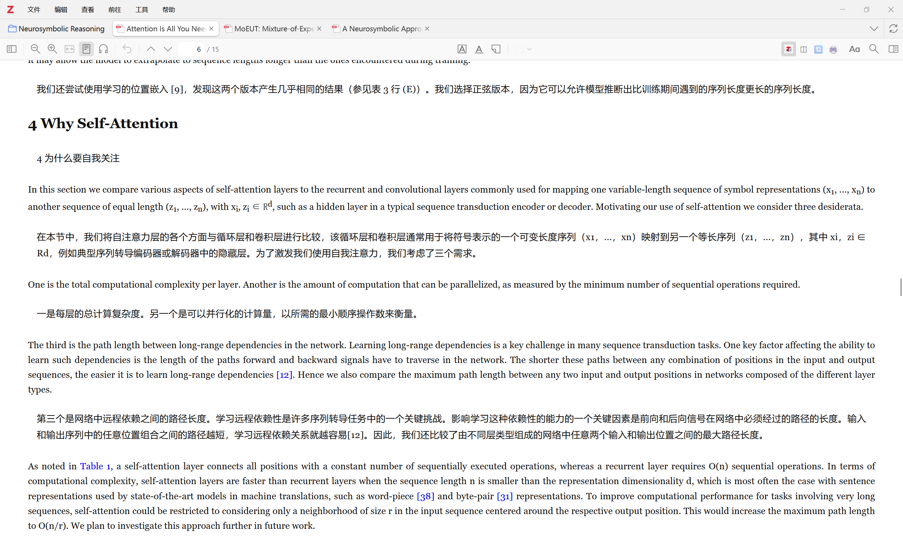
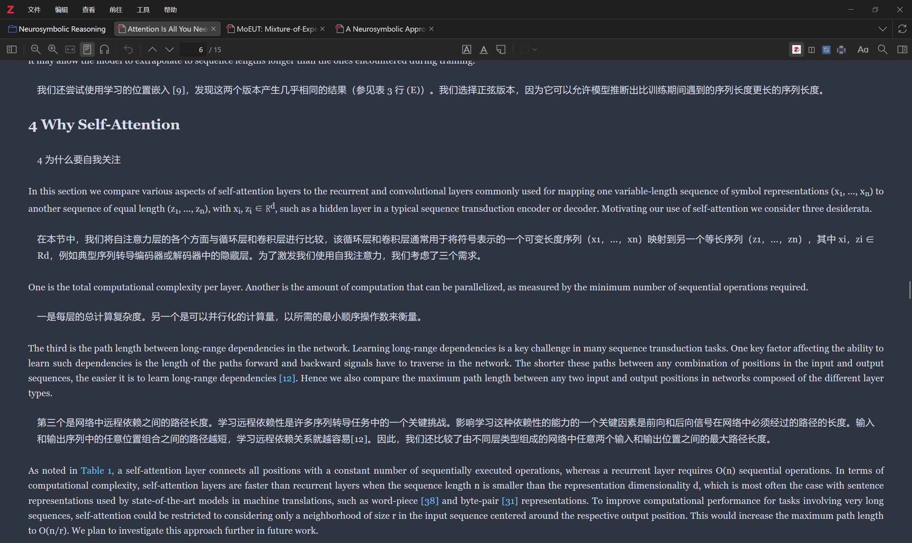
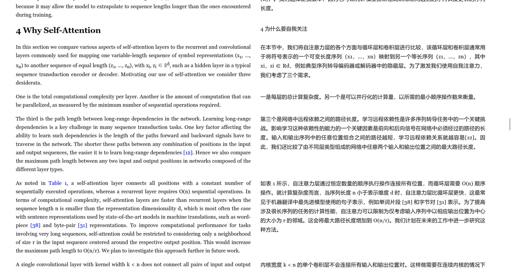
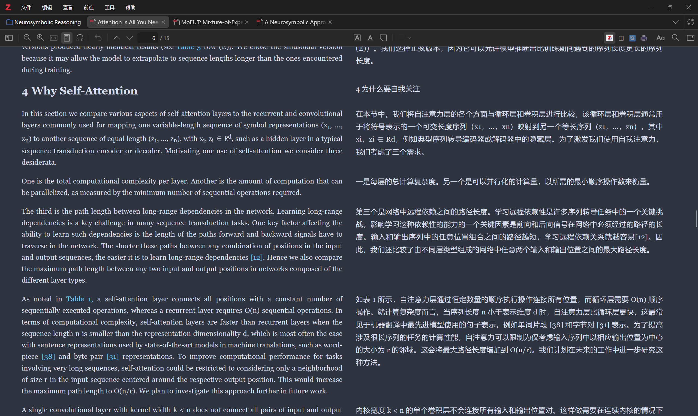
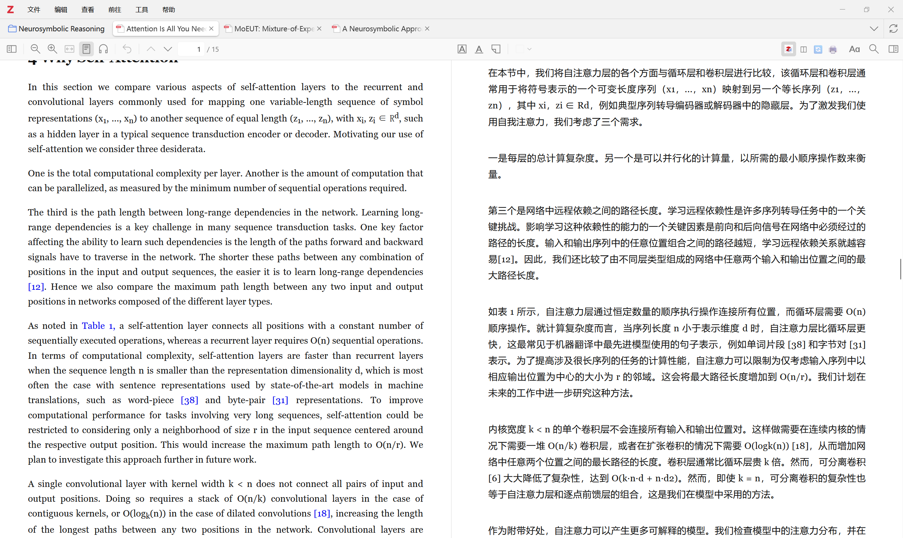
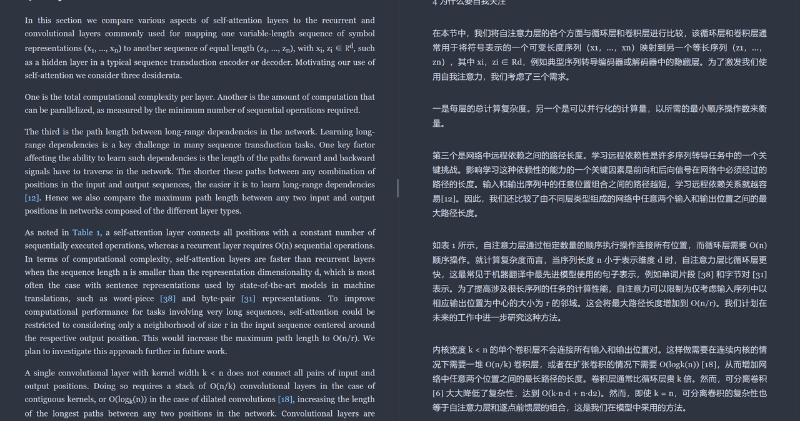

<p align="center">
  
</p>

# Interlinear

在 Zotero 10 里精读外文论文：每个原文段落下面，直接跟着它的译文。

Interlinear 接入桌面版 PDF 阅读器的阅读模式，逐段获取结构化文本的译文并渲染在原文旁边——不用再复制粘贴到翻译软件里来回切换。

[English](README.md) · [更新日志](CHANGELOG.md) · [贡献指南](CONTRIBUTING.md)

## 功能

- **内置五种翻译服务。** Google 免费翻译开箱即用、无需密钥（自动轮换多个独立配额池，被限流即时切换；也可选 MyMemory 或自建 LibreTranslate）；OpenAI 兼容接口、Anthropic Claude、Google Gemini、Ollama 在设置页填好即可使用，不依赖任何其他插件。
- **四种显示布局。** 译文在下、左右并排、仅译文、仅原文。旁边的显示模式按钮一键循环切换；左右并排时原文与译文首行对齐，且不影响 Zotero 原生高亮的位置。
- **一个工具栏开关。** 工具栏主按钮首次点击开启全文翻译，之后用于显示/隐藏译文；翻译进行中点击会暂停并隐藏，再次点击显示译文并继续未完成的段落。每个阅读器的状态互相独立。
- **读到哪翻到哪。** 鼠标停留、自定义快捷键、Alt 单击、划词弹窗，四种方式都能只翻当前段落，无需先开启全文翻译。
- **可控的全文翻译。** 工具栏显示进度、可随时取消；队列优先翻译当前视口并在翻页时重排；支持短段落合并、并发与节流、超时、连续失败自动暂停；失败段落点击即可重试。
- **术语表。** 支持 CSV / TSV 导入导出；术语会注入大模型提示词，并在所有服务（包括 Google）的返回结果上统一强制替换。
- **阅读助手。** 侧边栏聊天，可针对选中段落、当前页或全文提问（仅大模型类服务可用）。
- **双语 PDF 导出。** 把当前对照阅读结果重新排版为可搜索 PDF，自动存为该文献的 Zotero 附件。
- **译文外观自定义与实时预览。** 六套内置方案（默认、护眼纸张、学术衬线、高对比、暗色优化、极简）可一键应用并撤销；支持检测本机字体的可搜索字体列表、收藏、最多 6 个备选字体的字体栈构建器、按目标语言自动选字体；自实现 HSV 取色器（色相/饱和度/透明度/RGB/HSL/HEX）、浅深分别配色、最近使用与“我的颜色”；文字装饰（下划线/上划线/删除线及线型/粗细/偏移）、段落分隔线、色带位置/宽度/线型、译文块布局（内边距/圆角/边框/缩进/对齐/最大宽度/不透明度/原文淡化）；“我的方案”与 JSON 导入导出。
- **翻译缓存。** 按服务、语言对与术语表区分缓存，设置页可一键清理。
- 界面提供英文与简体中文；错误以阅读器内非阻塞提示条显示。

## 截图

真实 Zotero 10 窗口 + 真实翻译运行；图片就是 `docs/images/inbox/` 里的原图，未做拼接或修饰。每一对都是同一页、
同一位置，左亮右暗。演示论文是《Attention Is All You Need》（Vaswani 等，arXiv:1706.03762）；
译文由机器翻译生成，仅用于演示。论文按 arXiv 许可证分发（`arXiv non-exclusive distrib 1.0`，并非 CC BY），
此处仅作为本插件界面文档展示。

<table>
  <tr>
    <td width="50%"></td>
    <td width="50%"></td>
  </tr>
  <tr>
    <td align="center">上下对照 · 亮色</td>
    <td align="center">上下对照 · 暗色</td>
  </tr>
  <tr>
    <td width="50%"></td>
    <td width="50%"></td>
  </tr>
  <tr>
    <td align="center">左右双栏 · 亮色</td>
    <td align="center">左右双栏 · 暗色</td>
  </tr>
  <tr>
    <td width="50%"></td>
    <td width="50%"></td>
  </tr>
  <tr>
    <td align="center">左右分屏 · 亮色</td>
    <td align="center">左右分屏 · 暗色</td>
  </tr>
</table>

## 安装

> **安装或更新后请重启 Zotero。** 设置页与阅读器工具栏是在启动时注册的；不重启就打开设置，可能看到
> Interlinear 面板是空白的（文字是运行时注入的）。重启一次即可。

1. 从 [Releases](https://github.com/Muanyan-mjq/zotero-interlinear/releases) 下载最新的 `interlinear.xpi`。
2. 在 Zotero 中打开 **工具 → 插件 → 右上角齿轮 → 从文件安装插件…**，选择该 `.xpi`。
3. 如有提示，重启 Zotero。

仅支持 **Zotero 10 桌面版**。从原插件迁移过来的用户请先看[致谢](#致谢)一节。

## 配置

打开 **编辑 → 设置 → Interlinear**。设置页分为五个标签页，顶部保存栏与标签栏在滚动时保持可见；有改动未保存时会显示提示：

- **翻译服务**：选择翻译后端，填写各自的接口地址、模型与密钥，并为免费服务选择具体服务/配额池与自动切换策略；选择原文与译文语言。每个后端都有"测试连接"按钮，就地显示测试中、成功或具体失败原因（免费服务的测试直接使用表单里尚未保存的值）。
- **显示与交互**：默认布局、悬停翻译（开关、停留时间、无需修饰键/按住 Alt/按住 Ctrl）、单段翻译快捷键，以及可选的显示/隐藏与排版循环快捷键；快捷键冲突会提示。
- **译文外观**：实时预览、六套内置方案与“我的方案”、字体检测与字体栈构建器、取色器与浅深配色、文字装饰、段落分隔线、色带、译文块布局、界面跟随与导出外观。高级选项默认折叠。
- **术语表**：导入 / 导出术语文件。
- **高级**：翻译范围（正文/标题/图注/列表项/旁注）、跳过末尾页数、速度与可靠性参数、打开论文时自动翻译（关/仅缓存/总是）、翻译缓存用量与清理，以及版本与项目主页。

> **隐私与密钥。** 开启翻译即表示段落文本会发送给你配置的翻译服务——这一点无法避免，敏感文档请勿使用不可信的服务。API 密钥是另一回事：Interlinear 用 Zotero 的系统钥匙串接口（macOS Keychain、Windows DPAPI、Linux libsecret）加密密钥，偏好里只保存 `oskv1:` 开头的密文。密钥不会写入日志、缓存键、调试输出或导出的外观文件，并且通过请求头发送而不是 URL。非回环端点必须使用 HTTPS（除非你在设置页明确确认某个明文 HTTP 主机），带密钥的请求也不会跟随重定向。由于加密密钥绑定在你的系统账户上，把 profile 拷贝到另一台机器或另一个系统用户后无法解密——需要重新输入。Linux 上没有 Secret Service 时，默认只在本次会话使用密钥；以未加密方式保存是可能的，但必须在设置页内二次确认，之后会持续标记为“未加密”。0.6.0 及更早版本以明文保存的密钥会在首次启动时就地加密，明文读取路径保留到你下次保存该密钥为止。


### 免费翻译服务（无需密钥）

在 **翻译服务 → Google** 里可以灵活调整：

| 设置项 | 作用 |
| --- | --- |
| 免费翻译服务 | 默认「自动轮换」：依次尝试 Google 的 `it` / `at` / `gtx` / `dict-chrome-ex` / `firefox-a` 五个独立配额池，再退到 MyMemory 与自建 LibreTranslate。某个池返回 429 或人机验证时，**在当前这一批里立刻换下一个**，不会把段落标成失败。也可以固定只用一个服务。 |
| 失败时自动切换备用服务 | 固定某个服务后，它不可用时自动改用其它服务。 |
| Google 首选配额池 | 自动轮换从该池开始；各池独立限流，一个被封不影响其它。 |
| 接口地址 | 可填完整端点：Google 镜像、MyMemory 代理/镜像、LibreTranslate 实例。 |
| MyMemory 邮箱 | 可选，把每日免费额度从 5000 字符提高到 50000 字符。 |
| LibreTranslate API Key | 可选，与其它密钥一样加密保存在系统密钥库。 |
| 当前生效服务 | 显示此刻正在使用的服务，以及哪些服务正在冷却。 |

默认的 `translate_a/t` 端点一次请求可带多个段落，请求数约为逐段翻译的 1/6；全局 1 请求/秒的节流也在，避免短时间打爆配额。免费接口按 IP 限流，连续翻译几十篇后仍可能触发冷却：插件会暂停整轮、显示倒计时并自动恢复，而不是把每段标红。已翻过的段落走缓存，二次打开不消耗请求。追求稳定大批量建议改用模型后端。

> **隐私**：MyMemory 会把提交的文本加入其公开翻译记忆；敏感文献请勿使用该服务。

### 网络与代理

默认的 Google 端点需要能连通 `translate.googleapis.com`；MyMemory 与 LibreTranslate 备用服务分别需要连通其各自地址。Interlinear 的所有请求都走 Zotero 自己的 HTTP 层（`Zotero.HTTP.request`），所以用的是 Zotero 使用的代理——插件没有独立的代理设置，也无法绕过 Zotero 的代理配置。Zotero 本身是否跟随系统代理，取决于 Zotero 的网络偏好与操作系统设置（**此处未独立验证**）。

如果“测试连接”失败：先确认系统代理或 TUN 模式是否开启，再尝试其他翻译后端（OpenAI 兼容、Claude、Gemini 或本机 Ollama），最后才考虑你信任的镜像地址。失败提示现在会区分超时、DNS、连接被拒绝/重置、HTTP 状态码、限流、重定向与无法解析的响应，并给出对应建议。

## 使用

1. 在 Zotero 中打开 PDF，进入**阅读模式**。
2. 左键点击工具栏的 Interlinear 图标开始全文对照；已有译文后，同一按钮用于隐藏译文回到原文、再次点击恢复显示。翻译进行中点击会暂停并隐藏，再次显示译文时继续未完成段落。右键图标可重新翻译、取消、导出或打开设置。
3. 旁边的显示模式按钮循环切换四种布局。失败或暂停的段落会显示重试入口，点击只重试该段。
4. 阅读过程中，悬停段落、按快捷键、Alt 单击或划词即可只翻译当前部分；全文翻译进行中时，这些单段触发会复用在途请求，不会重复调用服务。
5. 在阅读器侧边栏打开阅读助手，可就选中段落、当前页或全文提问；工具栏菜单可将当前双语结果导出为 PDF 附件。

## 已知限制

- 仅支持桌面版 Zotero 10；不支持移动端与 Zotero 7。
- 依赖 Zotero 阅读模式的内部接口（非公开 API），Zotero 升级后可能失效，需要重新适配。
- 数学公式不翻译；表格不逐单元格翻译；图片内容不提取。
- 扫描版 PDF 的效果取决于 Zotero 自身文本层的质量。
- 导出是重新排版的双语 PDF，不是在出版社原始页面上叠加译文。
- 默认英文 → 简体中文；其他语言对的效果取决于所选服务与模型。

## 路线图（计划中）

以下为计划项，尚未实现，没有承诺的时间表：

- 表格逐单元格翻译。
- 跟进未来 Zotero 版本的阅读模式接口变化并适配。

## 开发

```bash
npm install
npm run build        # 类型检查 + 打包 .scaffold/build/interlinear.xpi
npm run lint:check   # ESLint
npm run test:unit    # Node 单元测试，无需 Zotero
npm run test:gui     # 采集真实设置窗口截图到 docs/dev/screenshots
npm run test:e2e     # 后端 e2e：默认只跑 mock 协议
npm start            # 开发服务器；先在 .env 配置 ZOTERO_PLUGIN_ZOTERO_BIN_PATH
```

集成测试使用真实的无头 Zotero：

```bash
ZOTERO_PLUGIN_ZOTERO_BIN_PATH="/path/to/zotero" npm run test:review
# 或标准入口：
ZOTERO_PLUGIN_ZOTERO_BIN_PATH="/path/to/zotero" npm test
```

设置对应环境变量后，`npm run test:e2e` 还会额外验证本机 Ollama 模型和
经本地代理访问真实 Google 接口：

```bash
INTERLINEAR_TEST_OLLAMA_MODEL=qwen2.5:7b INTERLINEAR_TEST_GOOGLE_PROXY_PORT=7897 \
ZOTERO_PLUGIN_ZOTERO_BIN_PATH="/path/to/zotero" npm run test:e2e
```

Windows 下路径通常为 `C:\Program Files\Zotero\zotero.exe`。CI 在每次推送到 `main` 时执行 lint、Ubuntu/macOS 构建与测试套件。

## 许可证

[AGPL-3.0-or-later](LICENSE)。

## 致谢

Interlinear 基于 [quillamio/bilingual-reader](https://github.com/quillamio/bilingual-reader)（AGPL-3.0-or-later）开发；改编来源与模板出处完整记录在 [NOTICE.md](NOTICE.md)。如果你之前使用原版 Bilingual Reader，请先卸载它再安装 Interlinear——首次启动时，旧版设置与翻译缓存会复制到 Interlinear 自己的命名空间，原有数据不会被清除。